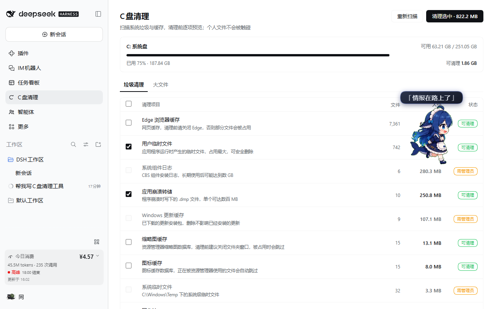
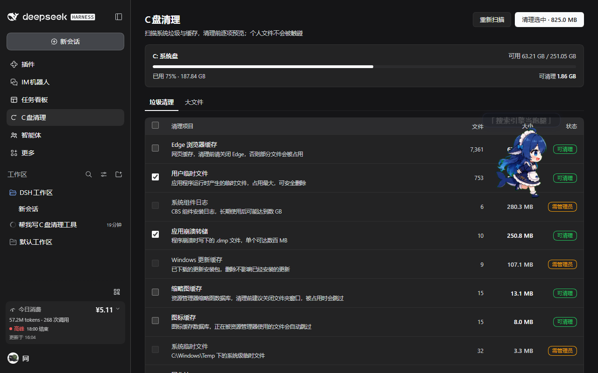
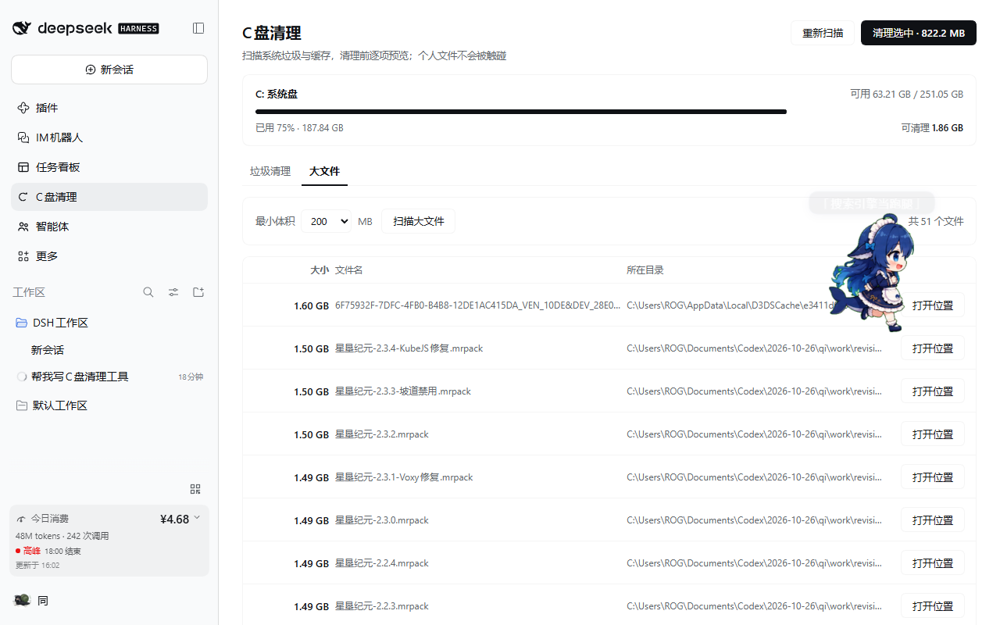

<div align="center">

# C盘清理 · dsh-c-cleaner

**DeepSeek Harness 的 Windows 系统盘清理插件**

扫描并清理 C 盘上的临时文件、缓存与更新残留，清理前逐项预览占用；
同时向 Agent 提供三个工具，让人和模型用同一套安全实现。

[](LICENSE)




</div>

## 功能

- **侧边栏面板**：磁盘占用条 + 18 个清理项，逐项显示大小、文件数与状态（可清理 / 需管理员 / 无内容 / 仅提示）
- **先预览再删除**：勾选 → 二次确认弹窗 → 清理 → 自动重新扫描，全程可看到每一项的真实占用
- **大文件排查**：整盘扫描体积最大的文件，按大小排序，一键定位到资源管理器
- **Agent 工具**：`c_cleaner_scan`（只读扫描）、`c_cleaner_clean`（需显式确认）、`c_cleaner_big_files`
- **跟随主题**：所有颜色取自 `--dsw-alias-*` 主题令牌，明暗主题自动适配
- **中英双语**：界面文案走 Harness 的 locale 服务





## 安装

需要 DSH 0.2.1 或更新版本，且**仅支持 Windows**（清理与系统查询依赖 Windows API）。

### DSH Desktop

打开 **设置 → 插件 → 添加插件**，填入：

```
github:Notch-da/dsh-c-cleaner
```

安装后在侧边栏出现「C盘清理」入口。

### dsh web / CLI

```sh
dsh plugin --profile <你的profile> add github:Notch-da/dsh-c-cleaner
```

装完重启 `dsh web`。

### 本地开发

```sh
dsh plugin --profile <profile> add /path/to/dsh-c-cleaner
```

profile 会把目录链接进去，改完代码用插件管理器关一次再开，Host 端即可热重载；Web 端刷新页面即可。

## 使用

点侧边栏的「C盘清理」，面板会自动扫描一次。默认勾选的是安全项（用户临时文件、系统临时文件、崩溃转储、错误报告、Internet 缓存），其余按需勾选。

- 「需管理员」的项目在普通权限下无法勾选，需要以管理员身份运行 DSH
- 「仅提示」的项目（Windows.old、hiberfil.sys、pagefile.sys）不提供自动删除，只显示占用并给出处理方式
- 「大文件」页扫描整盘约需 10–20 秒

### 清理项

| 项目 | 内容 | 权限 |
| --- | --- | --- |
| 用户临时文件 | `%TEMP%` | 普通 |
| 系统临时文件 | `%SystemRoot%\Temp` | 管理员 |
| 应用崩溃转储 | `%LOCALAPPDATA%\CrashDumps` | 普通 |
| Windows 错误报告 | `%ProgramData%\Microsoft\Windows\WER\*` | 管理员 |
| Internet 临时文件 | `%LOCALAPPDATA%\Microsoft\Windows\INetCache` | 普通 |
| 预读取文件 | `%SystemRoot%\Prefetch` | 管理员 |
| Windows 更新缓存 | `%SystemRoot%\SoftwareDistribution\Download` | 管理员 |
| 传递优化缓存 | DeliveryOptimization / Downloader | 管理员 |
| 系统组件日志 | `%SystemRoot%\Logs\CBS\*.log` | 管理员 |
| 内存转储文件 | `Minidump`、`LiveKernelReports` | 管理员 |
| 缩略图缓存 | `thumbcache_*.db` | 普通 |
| 图标缓存 | `iconcache_*.db` | 普通 |
| Edge / Chrome 缓存 | 各 profile 的 Cache、Code Cache、GPUCache | 普通 |
| 回收站 | C 盘回收站 | 普通 |
| 旧系统备份、休眠、虚拟内存 | 仅提示，给出处理方式 | — |

### Agent 工具

| 工具 | 说明 |
| --- | --- |
| `c_cleaner_scan` | 扫描全部清理项，返回大小、文件数与状态。只读 |
| `c_cleaner_clean` | 清理指定 id；必须传 `confirm: true`，否则直接拒绝 |
| `c_cleaner_big_files` | 列出大于指定体积的文件（默认 200 MB） |

## 安全设计

这是会删文件的工具，所以边界写死：

1. **白名单**：只处理 `index.js` 里 `categoryTable()` 明确列出的目录，从不递归整盘删除；`WinSxS`、`Installer`、Program Files、个人文档一律不碰
2. **不穿透链接**：遍历时跳过一切符号链接与目录联接（junction），防止顺着链接删到别处；沙箱测试已覆盖
3. **不删根**：只删除目录内容，声明的根目录本身永远保留
4. **不强制**：被占用的文件跳过并如实计数，不做强制解锁
5. **接口只回环**：`/api/dsh-cleaner/*` 只接受本机 127.0.0.1 请求，并校验 Host 头、拒绝带转发头的请求
6. **需确认**：面板有二次确认，Agent 工具要求 `confirm: true`

已知限制：回收站的大小查询与清空通过 PowerShell 的 Shell COM / `Clear-RecycleBin` 完成，约 1 秒开销；浏览器缓存与缩略图缓存中被进程占用的文件会被跳过，需关闭相应程序后重试。

## 兼容性

- 平台：Windows 10 / 11
- DSH：≥ 0.2.1（使用 `main` / `sidebar.panellist` 槽位与 `webServer` 路由）
- 无构建步骤：纯 ES Module，`index.js` 与 `client.js` 直接加载

## 开发

```sh
# 结构
index.js           Host：清理引擎 + HTTP 路由 + Agent 工具
client.js          Web：主面板、侧边栏图标、样式与文案
locale/*.json      插件管理器里的标题与描述
cordis.patch.yml   装配补丁
```

引擎自带一个可跑的沙箱测试思路：把 `TEMP` 指向临时目录，构造多级子目录 + 只读文件 + 指向外部的目录联接，然后断言扫描字节数、清理结果、外部文件未被删除、联接本身未被删除。

## 许可

[MIT](LICENSE)
